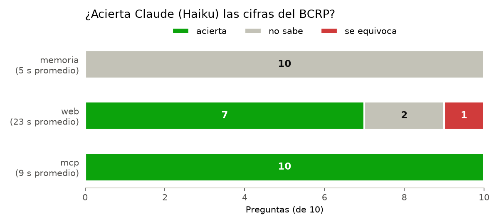

# Informe · Un MCP con las series oficiales del BCRP

## Resultados

Diez preguntas con la cifra oficial del BCRP, hechas a Claude Haiku con `claude -p` en tres modos: sin herramientas
(memoria), con búsqueda web (web) y con este MCP (mcp). Datos en `resultados.csv`; la corrida base, solo memoria
contra MCP, está en `resultados_base.csv`.

| Modo | Acierta | No sabe | Se equivoca | Segundos promedio |
|---|---|---|---|---|
| memoria | 0 | 10 | 0 | 4.9 |
| web | 7 | 2 | 1 | 23.4 |
| mcp | 10 | 0 | 0 | 9.2 |

En la corrida base (`resultados_base.csv`) el resultado fue el mismo: memoria 0 de 10 (10 «no sé») y MCP 10 de 10.

## Qué falló cada modo y por qué

- **Memoria:** respondió «no sé» en las 10. Todas las cifras son de 2025 y 2026, después de lo que el modelo
  aprendió, y la instrucción le permitía poner `null` en vez de estimar. No inventó ninguna cifra.
- **Web:** acertó 7 de 10, pero tardó el doble o el triple que el MCP.
  - `cobre_ago26`, **se equivoca** (651 contra 689.7): encontró una serie del BCRP, pero otra. Leyó la cotización
    del cobre en la Bolsa de Metales de Londres (LME, PN01652XM) en vez del precio de exportación (PN38784BM). La
    columna `fuente` muestra que la cifra salió de un resumen de la página, sin revisar el código de la serie.
  - `ipc_set26` y `desempleo_set26`, **no sabe**: el dato es muy reciente, la web del INEI y la del BCRP
    bloquearon la descarga, y la página de la serie solo mostraba metadatos. Encontró valores aproximados (4.55 % y
    4.4 %) en una sola fuente o en prensa y prefirió no darlos.
- **MCP:** acertó las 10. En cada respuesta citó el código de la serie, el periodo y la URL de la API, porque
  `buscar_series` y `serie` devuelven esos datos y las cuentas las hace Python en `resumen`.

## Dos cifras comprobadas a mano en la web del BCRP

| Pregunta | Cifra del MCP | Tabla del BCRP |
|---|---|---|
| Tasa de desempleo de Lima Metropolitana (promedio móvil 3 meses), setiembre 2026 | 4.37 % | [PN38063GM](https://estadisticas.bcrp.gob.pe/estadisticas/series/mensuales/resultados/PN38063GM/html) |
| Precio promedio del oro, agosto 2026 | 4,411.15 US$/oz troy | [PN38793BM](https://estadisticas.bcrp.gob.pe/estadisticas/series/mensuales/resultados/PN38793BM/html) |

## Herramienta propia

`comparar_paises` consulta la API del Banco Mundial para comparar al Perú con otros países en un indicador (por
ejemplo crecimiento del PBI, inflación o desempleo), porque el BCRP solo publica datos del Perú. Devuelve los valores
por país y año, y la URL de la fuente.

## Conclusión

Un MCP vale la pena cuando las preguntas se repiten sobre una misma fuente con datos que cambian seguido y donde un
error de serie o de periodo cuesta caro: acierta todas, tarda menos y cita una fuente exacta y repetible. La búsqueda
web basta para dudas puntuales o datos ya publicados en prensa, pero tarda más, puede confundir series parecidas
(como el cobre) y se queda sin respuesta cuando el dato es muy nuevo. Sin herramientas, el modelo no sirve para cifras
recientes: lo mejor que puede hacer es reconocer que no sabe.
